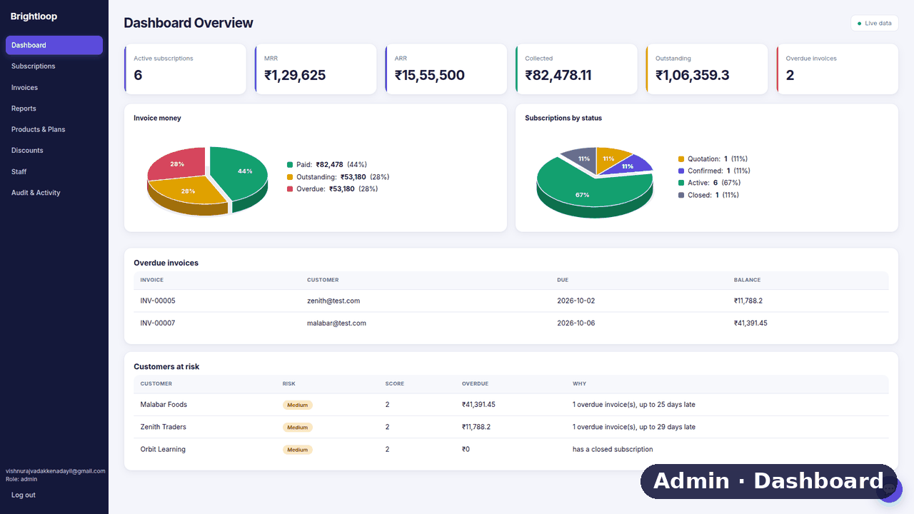
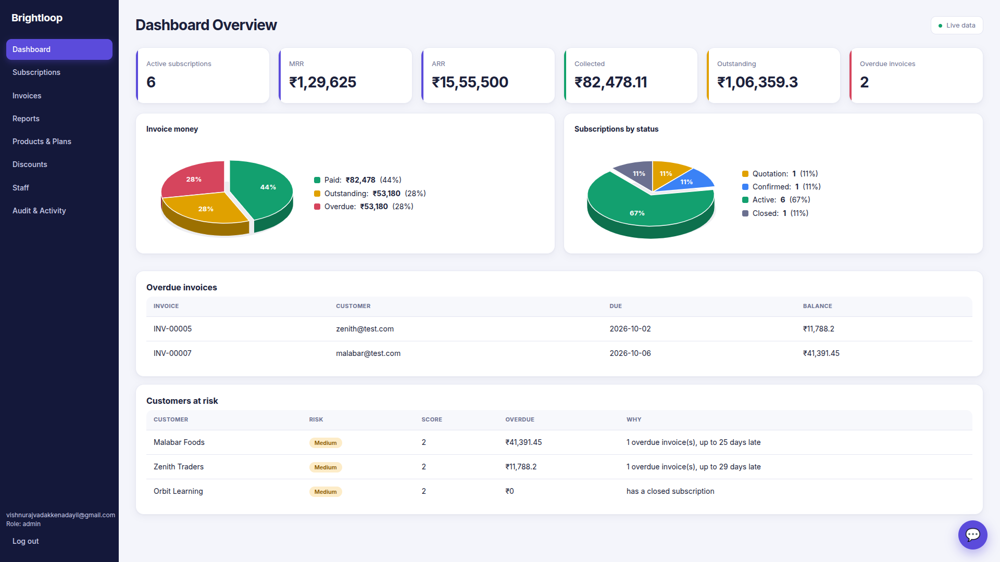
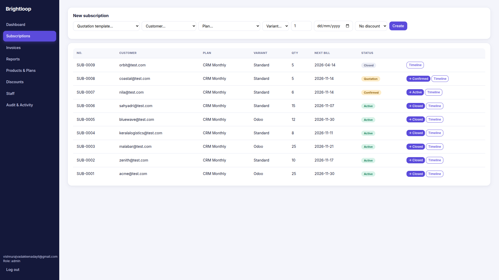
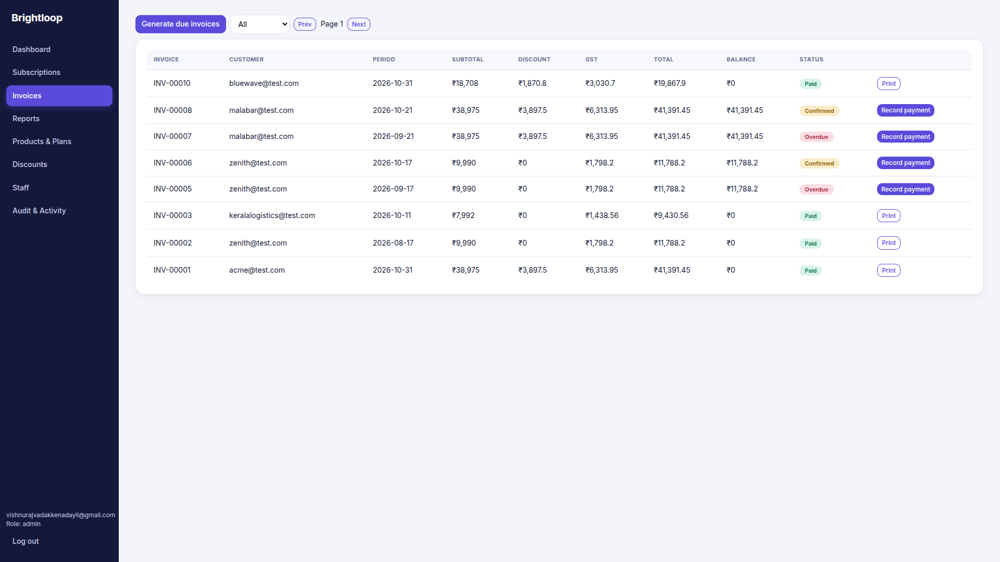
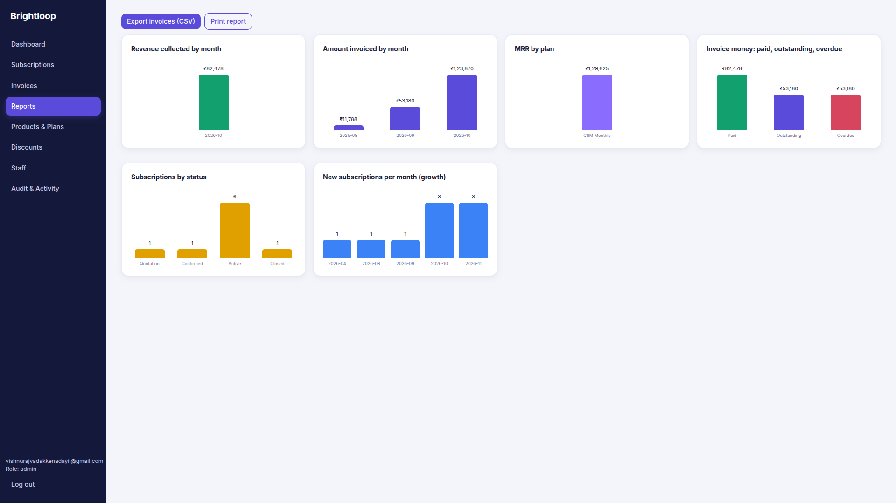
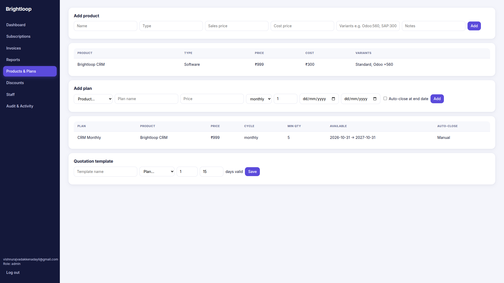
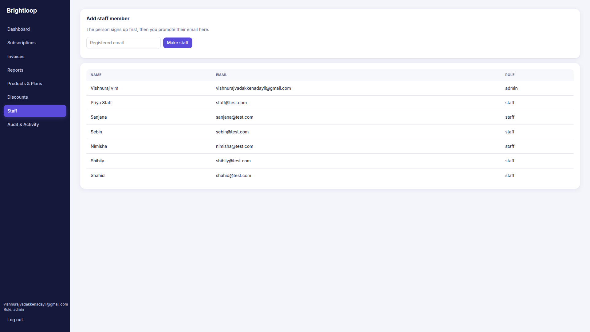
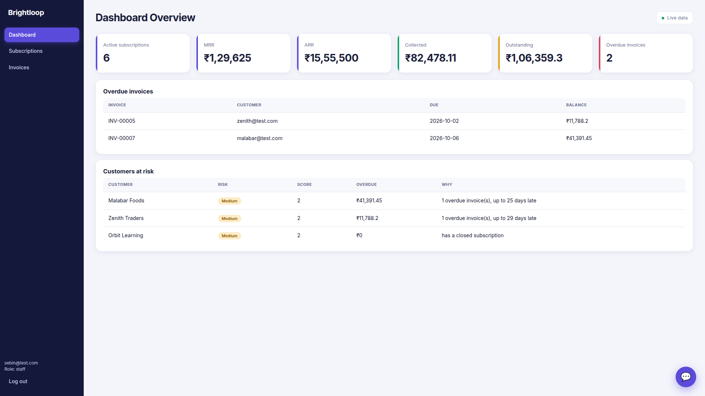
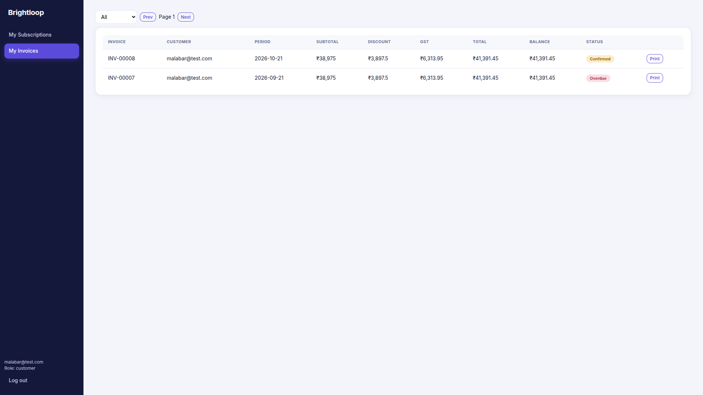
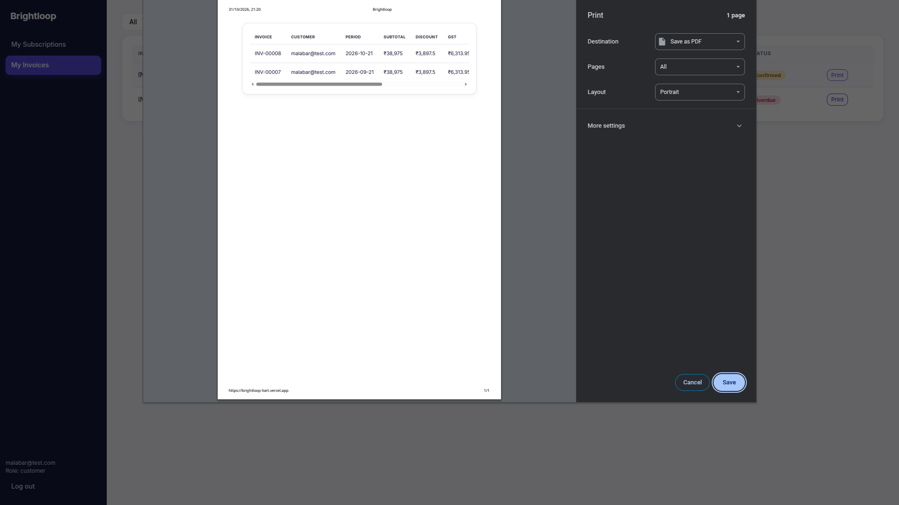

<div align="center">

# Brightloop

**Subscription billing, made simple.**

Manage products, plans, subscriptions, invoices and payments in one platform, with separate dashboards for **admins**, **staff** and **customers**.

**[Live Demo](https://brightloop-liart.vercel.app)**


</div>

<div align="center">



</div>

---

## Overview

Brightloop is a full-stack subscription billing system built for businesses that sell recurring products and services. It covers the whole billing lifecycle: creating products and plans, issuing quotations, activating subscriptions, generating invoices with GST, recording payments, and tracking revenue and risk through live reports.

> **Real data, real database.** Nothing in Brightloop is hardcoded or mocked. Every figure on every screen (MRR, ARR, collected revenue, overdue invoices, charts) is calculated live from a **Supabase PostgreSQL database**. The sample customers use `@test.com` emails because they are test records, but they live in the database and flow through the same code as production data.

---

## Screenshots

<details>
<summary><b>Click to view all screenshots</b></summary>

### Admin dashboard


### Subscriptions


### Invoices


### Reports


### Products & Plans


### Staff management


### Staff view


### Customer view


### Printable invoices


</details>

---

## Features

### Dashboard
- Live KPI cards: **active subscriptions, MRR, ARR, collected revenue, outstanding amount and overdue invoices**
- 3D pie charts for **invoice money** (paid / outstanding / overdue) and **subscriptions by status**
- **Overdue invoices** table with due dates and balances
- **Customers at risk** panel with a risk level, score, overdue amount and the reason (for example "1 overdue invoice, up to 25 days late")

### Subscriptions
- Create a subscription from a **quotation template**, customer, plan, variant, quantity, start date and discount
- Lifecycle workflow: **Quotation → Confirmed → Active → Closed**
- Per-subscription **Timeline** to follow its history
- Auto-generated subscription numbers (`SUB-0001`, `SUB-0002`, ...)

### Invoices
- **Generate due invoices** in one click for every subscription that is due
- Itemised amounts: subtotal, discount, **GST**, total and balance
- Statuses: **Confirmed, Paid, Overdue**
- **Record payment** against an invoice
- Filter by status and paginate through the list
- **Print / save as PDF** for any invoice
- Auto-generated invoice numbers (`INV-00001`, ...)

### Reports
- Revenue collected by month
- Amount invoiced by month
- MRR by plan
- Invoice money: paid, outstanding, overdue
- Subscriptions by status
- New subscriptions per month (growth)
- **Export invoices to CSV** and **print the report**

### Products & Plans
- Add products with type, sales price, cost price, **variants with extra pricing** (for example `Odoo:560`) and notes
- Create plans with billing cycle, minimum quantity, availability window and an **auto-close at end date** option
- Save **quotation templates** with a validity period in days

### Discounts, Staff and Audit
- **Discounts** that can be applied to subscriptions
- **Staff management:** people sign up first, then an admin promotes their email to staff
- **Audit & Activity** log to track what happened in the system

### Chat assistant
- A floating **chat assistant** sits at the bottom-right of the dashboard, so you can ask questions and get help without leaving the page you are working on.

### Role-based access

| | Admin | Staff | Customer |
|---|:---:|:---:|:---:|
| Dashboard with charts | Yes | KPIs and risk tables | - |
| Subscriptions | Manage all | View and work | Own only |
| Invoices | Manage all | View and work | Own only |
| Reports | Yes | - | - |
| Products, Plans, Discounts | Yes | - | - |
| Staff and Audit | Yes | - | - |
| Chat assistant | Yes | Yes | - |

Each role sees only the pages and records it needs. Customers see just **My Subscriptions** and **My Invoices**, filtered to their own account.

---

## Tech Stack

| Layer | Technology |
|---|---|
| Frontend | React with Vite |
| Database | Supabase (PostgreSQL) |
| Authentication | Supabase Auth |
| Charts | Custom React / SVG chart components (3D pie charts, bar charts) |
| Hosting | Vercel |
| Currency | Indian Rupee (₹) with GST |

---

## Getting Started

### Prerequisites
- Node.js 18 or later
- A free [Supabase](https://supabase.com) project

### 1. Clone and install
```bash
git clone https://github.com/vishnurajvadakkenadayil-jpg/Brightloop.git
cd Brightloop
npm install
```

### 2. Configure environment variables
```bash
cp .env.example .env
```
Then edit `.env`:
```env
VITE_SUPABASE_URL=your-supabase-project-url
VITE_SUPABASE_ANON_KEY=your-supabase-publishable-key
```

### 3. Set up the database
In the Supabase **SQL Editor**, run these files in order:
1. `supabase/schema.sql`
2. `supabase/reports.sql`

### 4. Run the app
```bash
npm run dev
```
Open `http://localhost:5173`.

### Build for production
```bash
npm run build
```

---

## Project Structure

```
Brightloop/
├── src/
│   ├── App.jsx          # App shell, login, role-based pages
│   ├── Reports.jsx      # Reports page and charts
│   ├── PieCharts.jsx    # 3D pie chart components
│   ├── supabase.js      # Supabase client
│   ├── main.jsx         # Entry point
│   └── styles.css       # Styling
├── supabase/
│   ├── schema.sql       # Tables, relationships and access rules
│   └── reports.sql      # Reporting queries and views
├── docs/screenshots/    # README images
├── index.html
├── vite.config.js
└── package.json
```

---

## Deployment

Brightloop is deployed on **Vercel**:

1. Push the repository to GitHub.
2. Import it in Vercel (framework preset: Vite).
3. Add `VITE_SUPABASE_URL` and `VITE_SUPABASE_ANON_KEY` under **Environment Variables**.
4. Deploy. Every push to `main` redeploys automatically.

---

## Author

**Vishnuraj**
GitHub: [@vishnurajvadakkenadayil-jpg](https://github.com/vishnurajvadakkenadayil-jpg)
